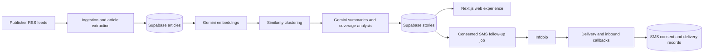

# NewsLens KE

**One event. Many newsroom perspectives. A clearer picture.**

NewsLens KE is an early-stage Kenyan news intelligence product that brings reporting about the same event together. It helps readers compare coverage across outlets, understand what each source emphasizes, and see which claims are reported by multiple sources.

> NewsLens organizes and compares reporting; it does not determine whether a claim is true or replace original journalism.

## The Problem

News is abundant but fragmented. An important event can appear across many publishers, each with a different headline, framing, and level of detail. Readers must find those reports, identify that they describe the same event, and compare them themselves. That takes time and makes it harder to distinguish broad agreement from details reported by only one outlet.

## The Product

NewsLens KE turns separate articles into a browsable, cross-source view of a story:

- **Story discovery:** groups related coverage into a single story page and ranks the homepage using recency and reporting volume.
- **Coverage comparison:** shows participating outlets, article links, and a concise summary of the shared event.
- **Perspective view:** presents model-generated notes about what each outlet emphasized.
- **Claim comparison:** separates claims attributed to multiple outlets from claims currently attributed to one outlet.
- **Coverage categories:** gives readers a way to explore stories by their dominant coverage angle.
- **Fact-check discovery:** surfaces semantically related fact-check articles where available.
- **SMS channel:** the codebase includes a manually triggered story SMS and a Monday follow-up job for opted-in subscribers. Follow-ups are disabled by default and require database migrations and provider/webhook setup before production use.

Original articles remain linked to their publishers. Summaries, categories, and claim groupings are machine-generated and should be checked against the cited reporting.

## How It Works

The web experience reads stories, articles, and sources from Supabase. A scheduled pipeline is configured to run hourly for ingestion, embedding, clustering, and summarization. The follow-up job checks its configured day and send window in `Africa/Nairobi`, independently of the server timezone.

## Technology

| Area | Technology |
| --- | --- |
| Web application | Next.js App Router, React, TypeScript |
| UI | Tailwind CSS, Lucide icons, Recharts |
| Database and API | Supabase Postgres, Supabase JS, pgvector |
| Collection | RSS Parser, article extraction, Mozilla Readability |
| AI processing | Google Gemini for embeddings and structured story summaries |
| SMS | Infobip SMS API, authenticated DLR and inbound webhooks |
| Hosting and scheduling | Vercel configuration; scheduled routes use `CRON_SECRET` |

## Product and Business Hypotheses

The product is designed for people and organizations that need a faster view across publishers: news readers, newsrooms, civic organizations, researchers, and policy teams. Potential directions to test include a reader subscription, newsroom research tools, or an institutional/API offering. These are hypotheses, not current revenue or customer commitments.

Early validation should measure whether people return to compare coverage, whether cross-source summaries save time, which source and topic combinations are most useful, and whether consent-based SMS improves follow-through. No user-growth, accuracy, revenue, or impact figures are claimed in this repository.

## Trust and Responsible Use

- NewsLens links to source articles and distinguishes multi-source claims from single-source claims; corroboration is not proof of truth.
- Coverage categories and perspective notes are model-generated classifications, not definitive labels of a publisher's political position.
- Fact-check matches are based on topical similarity and should be read in their original context.
- SMS follow-ups require explicit opt-in, re-check opt-out status before sending, include `Reply STOP to opt out`, and have a database-enforced per-story duplicate guard.
- Provider keys, database credentials, phone numbers, and webhook tokens belong in local/server environment configuration, never in source control.

## Project Status

NewsLens KE is an early-stage prototype. The repository contains the web experience and news-processing pipeline, along with SMS follow-up code and tests. The follow-up feature is opt-in at deployment time and is not production-ready until its Supabase migrations are applied, Infobip callbacks are configured, and the live delivery path is verified. Story-open tracking is not currently implemented; follow-ups therefore select the most recent eligible story sent to each subscriber.

## Run Locally

### Requirements

- Node.js 22 or later
- A Supabase project with the repository migrations applied
- A Gemini API key for embedding and summary jobs
- Infobip credentials only if testing SMS

### Setup

1. Install the locked dependencies with `npm ci`.
2. Create `.env.local` from [.env.example](.env.example) and set the values required for the parts of the system you are running. Do not commit `.env.local`.
3. Start the application with `npm run dev` and open `http://localhost:3000`.

The web app needs `NEXT_PUBLIC_SUPABASE_URL` and `SUPABASE_SERVICE_ROLE_KEY`. The ingestion and embedding scripts need Supabase access and `GEMINI_API_KEY`; clustering also needs `DATABASE_URL`. Apply Supabase migrations in order before using features that depend on their tables or functions.

### Common Commands

| Command | Purpose |
| --- | --- |
| `npm run dev` | Start the Next.js development server |
| `npm run build` | Build the application |
| `npm run lint` | Run ESLint |
| `npm test` | Run entity-overlap and SMS follow-up tests |
| `npm run ingest` | Fetch RSS items and extract article text |
| `npm run embed` | Generate missing article embeddings |
| `npm run cluster` | Group recent articles into stories |
| `npm run summarize:stories` | Generate summaries and coverage analysis |

## SMS Follow-up Operations

Follow-ups are disabled unless `FOLLOWUP_ENABLED=true`. Keep `FOLLOWUP_DRY_RUN=true` while validating; dry-run logs a masked destination and message but sends nothing and writes no delivery record. The scheduled endpoint is `/api/cron/sms-followup` and requires `Authorization: Bearer <CRON_SECRET>`.

The Vercel cron expression targets Monday 05:00–08:45 UTC, corresponding to the default Nairobi 08:00–11:45 window. The handler enforces the exact configured window and stops at its end. If changing `FOLLOWUP_DAY` or `FOLLOWUP_TIMEZONE`, update `vercel.json` as well. A manual single-recipient test uses `GET /api/cron/sms-followup?manual=true` with `TEST_MSISDN`; this bypasses only the day/window check, not consent or eligibility. Set `FOLLOWUP_DRY_RUN=false` only for an explicitly intended live send.

Configure Infobip DLR and inbound webhooks to:

- `POST /api/sms/infobip/dlr`
- `POST /api/sms/infobip/inbound`

Both endpoints require `Authorization: Bearer <INFOBIP_WEBHOOK_TOKEN>`. A test sender and trial account may limit recipients to verified numbers. The current story-page SMS sends to the configured `INFOBIP_RECIPIENT`; cohort follow-ups require consented subscriber records and corresponding story delivery records.

## Environment Variables

See [.env.example](.env.example) for the full blank template. Core values include:

| Variable | Used for |
| --- | --- |
| `NEXT_PUBLIC_SUPABASE_URL` | Supabase project URL |
| `SUPABASE_SERVICE_ROLE_KEY` | Server-side Supabase access; keep secret |
| `DATABASE_URL` | Direct/pooler Postgres access for pipeline scripts |
| `OpenAI_API_KEY` | Embeddings and story summaries |
| `APP_BASE_URL` | Public origin used to construct story links |
| `CRON_SECRET` | Protects scheduled job endpoints |
| `INFOBIP_BASE_URL`, `INFOBIP_API_KEY`, `INFOBIP_SENDER` | Infobip SMS API configuration |
| `INFOBIP_RECIPIENT` | Configured recipient for the manual story SMS |
| `INFOBIP_WEBHOOK_TOKEN` | Protects Infobip DLR and inbound callbacks |
| `FOLLOWUP_ENABLED` | Enables the scheduled follow-up; default `false` |
| `FOLLOWUP_DRY_RUN` | Logs planned follow-ups without sending; default `true` |

Never paste credentials into issues, pull requests, screenshots, or chat. Rotate any key that has been exposed.

## Validation and Open Work

The automated tests cover Nairobi window boundaries, eligibility, GSM-7 length, link construction, opt-out rechecks, batch/idempotency behavior, dry-run, manual mode, and retry handling. The live SMS flow still requires applied Supabase migrations, configured Infobip callbacks, and a verified trial recipient. Story-open tracking and an in-app SMS subscriber enrollment flow are not implemented yet.
